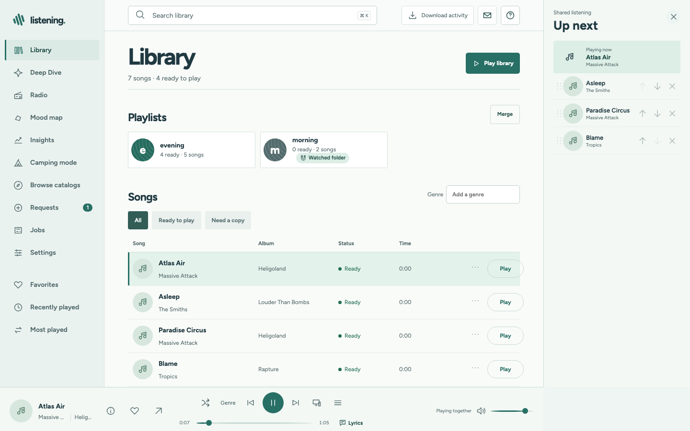

# Listening Room

## Stream the records you own.

Build a music library from the files on your computer, external drive, or home server. Play it across your devices, explore the artists behind a record, and save a mix for the road.

[Get started](#your-first-run) · [See what it supports](#what-you-can-do) · [Download apps](https://github.com/Warkanlock/listening-public/releases)

## What you can do

| | |
| --- | --- |
| **Bring your collection** | Import tagged MP3, AAC, M4A, and FLAC files from folders you choose. Add or merge portable playlists, watch for new files, and search by artist, album, song, or genre. |
| **Follow the music** | Browse artist and album pages, trace recording credits, read synced lyrics when available, and find recommendations through Mood Map and Deep Dive. |
| **Play it your way** | Build a queue, shuffle a genre with Library Radio, and resume a song where you left off on another device. |
| **Make it a room** | Pair devices and set up separate household profiles. Play together with Nearby Jams or share a playlist as a portable track list. |
| **Take it offline** | Buffer upcoming songs or save a Camping mix for a trip. Android also plays files on your device or removable storage. |
| **Keep it portable** | Export your audio, connect another compatible player, or move the whole collection with a backup. Optional add-ons can handle search and audio retrieval. |

Open **About** in your room for the full searchable feature list and a tour of the player. [Local feature tour](http://127.0.0.1:8765/about/)

## Your first run

Choose a computer to host Listening. It holds the library. Open the room on the other devices you want to listen on.

<strong>Mac</strong>

1. Download the Mac DMG, drag Listening Room to Applications, and open it. The Mac app runs on Apple silicon with macOS 13 or later.
2. To join a room, enter its address or paste your invitation.
3. To host a new room, choose **Listening Room → Install terminal command**. Open Terminal, run `~/.local/bin/listening setup`, and choose a music folder.

[Download for Mac](https://github.com/Warkanlock/listening-public/releases) · [Mac setup guide](clients/macos/README.md)

<strong>Linux server</strong>

1. Install Docker with Compose and get the Listening release files.
2. Follow the server guide to start your room, choose a music folder, and create your owner login.
3. Open the address shown by setup. In the Library, open **Owned music** and play a track.

[Linux server guide](docs/private-install.md#start-a-room-with-docker-compose) · [Run from source](docs/operations.md#from-source-developers-and-forks)

<strong>iPhone and iPad</strong>

1. Open your room address or invitation in Safari.
2. Tap **Share → Add to Home Screen**, then open Listening from the new icon.

Use a trusted HTTPS room and save the mix from the Home Screen app for offline Camping. [iPhone and iPad guide](clients/ipad/README.md)

<strong>Android</strong>

1. Download and open the Listening APK. Allow installation from your browser or Files app if prompted.
2. Open Listening and enter your room address or invitation. You can also open music already on the device.

[Download for Android](https://github.com/Warkanlock/listening-public/releases) · [Android guide](clients/android/README.md)

<strong>Browser or Windows</strong>

Open your room address or invitation in a browser on the room’s private network. Sign in or pair when prompted.

Already have a room? **Settings → Connect a device** shows the address, pairing options, and any installers available from that room. [Private network setup](docs/private-install.md#choose-how-devices-reach-the-room)

To find missing recordings, open **Settings → Extensions** in your room. Follow the [plugin setup guide](docs/download-engines.md) to configure **Find copy**, or browse the [Listening Plugins repository](https://github.com/Warkanlock/listening-plugins-public) for available engines.

## Preserve or move a collection

Use a collection snapshot to move your catalog and original audio to another host. Use a portable library ZIP to take playlists and metadata. Keep the server’s private settings and credentials in a separate backup. [Snapshot and restore](docs/operations.md#preserve-or-move-a-collection)

## Documentation

| Guide | Covers |
| --- | --- |
| [Server installation](docs/private-install.md) | Owner setup, music import, private access, and updates |
| [Music storage and playback](docs/music-storage-and-playback.md) | Import, play, buffer, export, and sync |
| [Discovery and Radio](docs/operations.md#radio) | Library Radio, discovery, and optional sources |
| [Build an add-on](examples/engines/README.md) | Search and retrieval engines and a working example |
| [Operations](docs/operations.md) | CLI, backups, sharing, and troubleshooting |
| [Portable formats](SPEC.md) | CSV, M3U, XSPF, and other portable formats |
| [Client releases](docs/client-releases.md) | Build, sign, and verify installers |
| [Public release preparation](docs/public-release.md) | Review the source, history, and release assets before publication |

## Contributing

See [CONTRIBUTING.md](CONTRIBUTING.md) to set up a development room. See [SECURITY.md](SECURITY.md) to report a vulnerability privately.

[MIT license](LICENSE) · [Third-party notices](THIRD_PARTY.md)
