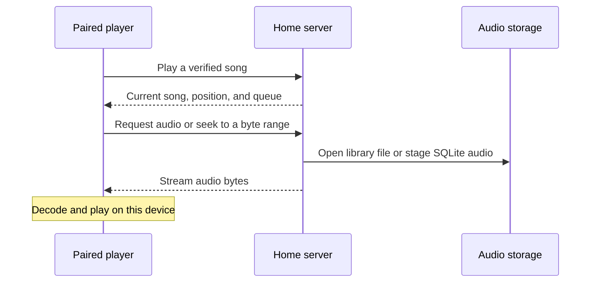

# Music storage, playback, and offline listening

Listening keeps your collection on the home server. Paired players can listen from the same queue. For a trip, save playlists to an offline Android player, sync the Android app, or take exported audio files with you.

## Where the music lives

These are the default host directories next to the Compose file. You can choose other paths when you install. [Private installation](private-install.md)

| Location | What it holds |
| --- | --- |
| `library/` | The active library. New and restored rooms keep original audio, the catalog, playlists, and play history in `collection.sqlite3`. Older rooms can still keep audio in `media.sqlite3` and catalog state in the application folder’s `requests.sqlite3`. |
| `config/` | Owner credentials, pairing, settings, jobs, temporary transfers, and playback caches. |
| Optional import folder | A folder of music you already have. Listening reads it and preserves the files you put there. Its `Playlists/` folder can supply track lists. |
| Export folder | Playable files and an M3U8 manifest in playlist order. Choose where to keep the files you export. |

A playlist can name songs before audio is available. Bring your own files through the import folder or request a copy through your configured download plugins. Listening keeps incoming files in private staging. Listening verifies the audio before it can be played. It releases byte-identical staging files once it has confirmed the stored copy. Verified transfers can wait in staging when there is too little room to land them within the 20 GiB free-space reserve.

SQLite keeps one payload per SHA-256 hash of the original bytes. Multiple tracks can point to the same payload. Different encodings of the same recording have different hashes. When reversible compression saves space, Listening stores the smaller representation and recovers the original bytes for playback or export. Music share originals, explicit exports, and device saves each take up space where you keep them. [Collection storage decision](../adrs/0006-collection-ownership.md)

## What happens when you press Play

1. **The room updates the shared queue.** The server records the song, position, and what comes next. Paired players that join follow the same session. When the server restarts, it restores a previously playing session in a paused state.
2. **The server opens the verified audio.** For a song stored in SQLite, Listening prepares the original file in a rolling three-track disk cache. On Python 3.11 and newer, idle staged copies expire after five minutes. For a legacy file-backed track, it opens the existing library file.
3. **Your device plays the stream.** The player can request a byte range to seek within a song. The room player buffers the current track and one to three upcoming tracks on your device, up to 128 MiB. Choose **Buffer ahead** in Playback settings. The web standby player reuses this same buffer. [Playback design](../adrs/0013-local-playback-and-lyrics.md)

**Original** is the default. In the web and Apple players, enable **Settings → Playback → Compact mobile audio** for smaller AAC streams. Android offers **Compact AAC** and **Compact Opus** under **Mobile audio**. The first request can take longer while the server prepares a Compact copy. Listening reuses compatible already-small originals or cached copies. The original stays in SQLite.

If a song has no verified copy, **Find copy** opens the request flow. Confirm a lossless format to start the search. **Find on YouTube** opens an artist-and-title search when you want to listen elsewhere.

## Playback Insights

Open **Insights** to see the room's upcoming queue count and recent playback traffic for your device. The rates are shown in kilobits per second and average the last five seconds of audio sent by the room and playback commands sent back. Audio already buffered can play while the rate is zero. Direct provider streams and HTTP overhead are outside these readings.

## Listen from your devices

Pair each browser or app once with a private room invitation. Get it from **Settings → Devices → Pair a device** in a session with invitation permission, or run `listening invite` on the server. Connect to the LAN or start the VPN configured for the room. Open the address from your invitation. [Network setup](private-install.md#choose-how-devices-reach-the-room)

| Device | Player |
| --- | --- |
| Mac | Browser or the Listening macOS app |
| iPhone | Safari or the optional Listening app |
| iPad | Safari or the optional Listening app |
| Windows or Linux | Browser on the private network |
| Android | Listening for streaming, offline library sync, and **Device files** on internal or removable storage |

If the browser prompts you to **Join audio**, tap it on that device. [Private pairing](../adrs/0011-paired-private-network-access.md)

## Lyrics and the room player

Tap **Lyrics** in the web player or in **Playing** on Android to read along. When a library song has timed lyrics, the current line lights up. Tap a line to seek. Library Radio follows the song playing on that station. Lyrics need a connection to the room.

In a song’s **•••** menu, **Open in room player** brings up Now Playing. Opening the current song keeps its queue and position. Use **Playback devices** to choose where it sounds. Owners running Listening on a graphical desktop may also see **Open in server’s desktop music app**.

## Take music offline

### Camping mode

On the web, open **Camping mode** and choose **30**, **60**, or **90 songs**. Make mixes to preview a random selection of ready library tracks, then choose **Save on this device**. Smaller libraries use the songs available. The browser saves compact copies and lets you resume an interrupted download. Open the saved trip to play its mixes without the room, or remove it from that device when you are back.

Use a trusted HTTPS room address to reopen the browser player offline. On iPhone or iPad, open that address in Safari and add it to your Home Screen before saving. Downloads are specific to the browser and site address where you saved them. Keep the app or tab open while downloading.

On Android, open **Device files → Save for offline → Camping mode**. Choose the trip size and save the mixes to your phone or SD card. Afterward, open **Device files → Saved playlists**. The same tracks may appear in other playlists, and Android can reuse copies already saved in that folder.

### Save playlists to Android device files

1. On your home Wi-Fi, open **Device files → Save for offline**. Use your private invitation to connect.
2. Choose **Original**, **Compact Opus**, or **Compact AAC** under **Mobile audio**, then select a playlist.
3. Grant write access to the card’s **Music** folder if prompted. Confirm **Save to card** and leave the save screen open until it finishes.
4. Open **Device files → Saved playlists** and choose the playlist. Use **Resume** to pick up where you left off.

The save includes the room’s ready tracks in playlist order. Select the same playlist again to resume an interrupted transfer or pick up changes. Listening reuses matching verified files already on the card. Saved music plays with both radios off. You can also copy ordinary exported files over USB with your device’s file tools or use a file-sync app to mirror them. Keep the server’s live SQLite database outside the synced folder. [Android device files guide](../clients/android/README.md#play-or-save-device-files)

### Sync the Android app

On the server, enable **Settings → Devices → Allow offline sync** for the phone. On the phone, select **Settings → Keep an offline library → Enable and sync**. Leave the app open for the first sync. The app saves the catalog first, then copies available original audio into a private SQLite database. Entries whose audio has yet to arrive say **Not saved on phone**.

Use **On this phone** to play from that database with the phone’s own queue. **Listen with the room** returns to the shared player. **Sync now** retries interrupted transfers and reuses completed copies. Audio imported through **Add song from phone** goes back to the server for verification on the next sync. [Android offline library guide](../clients/android/README.md#take-a-room-offline)

### Take files to a Mac, iPhone, iPad, or another computer

Choose **Export playlist** on the server and select Original or a Compact format. Original exports recover the exact stored bytes. Copy the resulting files to the device and open them in a local player that supports the format. The browser and Apple apps can keep playing a short interruption using tracks already buffered on your device. Export a playlist for longer offline listening. [Export formats and commands](operations.md#listen-on-the-go)

## When the room is unavailable

- **Room unreachable.** Check your private network connection, then choose **Retry**.
- **Catalog still loading.** Give the server time to load the catalog, then choose **Retry**.
- **Pairing expired.** Choose **Pair again** and use a fresh private invitation.
- **Away without a connection.** Open your saved offline playlist, the Android offline library, or an exported file in a local player.
