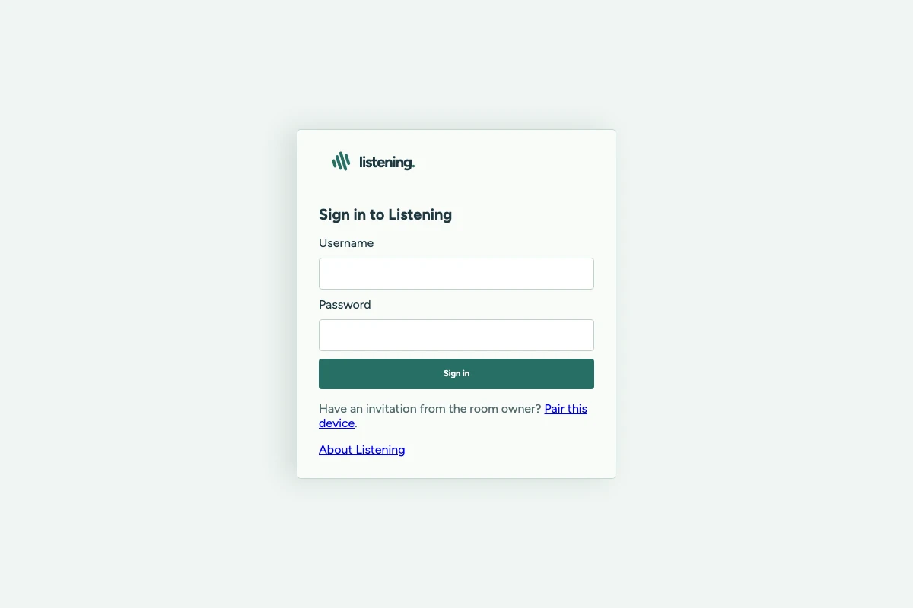
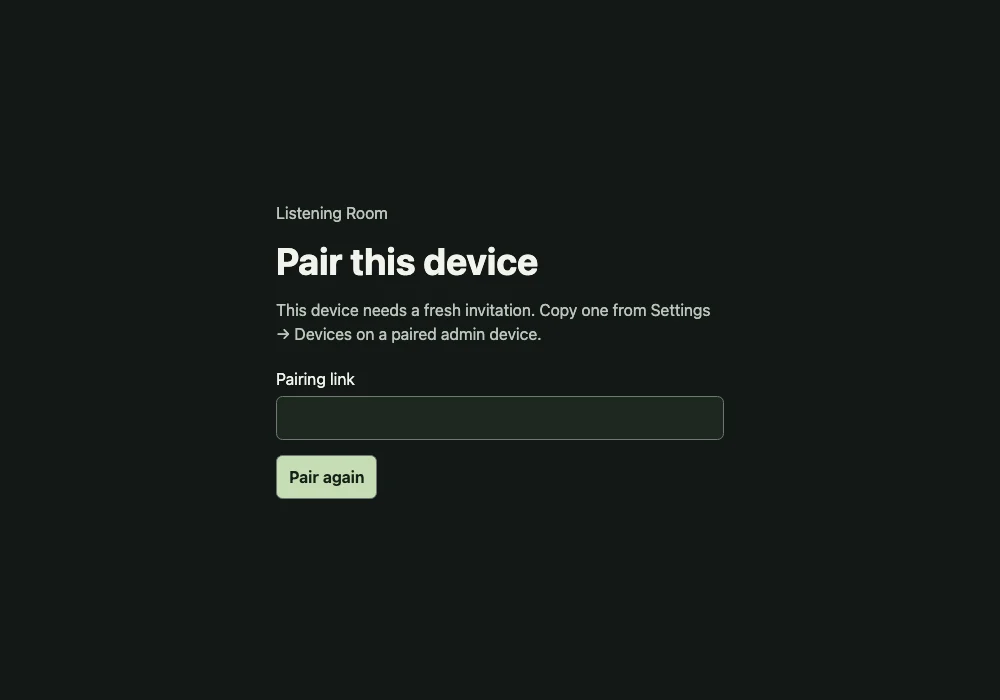

# Set up Listening

These screens come from a clean Listening 1.5.0 installation with a demo track. If you already have a room, review [backup and recovery](private-install.md#update-and-recover). For source-built Compose rooms, follow the [Compose update guide](private-install.md#update-a-source-built-compose-room-from-the-browser). Rooms with a download engine can follow the [engine upgrade guide](download-engines.md#upgrade-a-room-with-an-existing-engine).

## Start the server

1. Follow the [Docker installation](private-install.md#start-a-room-with-docker-compose) to build or load the image and create the persistent folders.
2. Run [the setup walkthrough](private-install.md#add-your-music-and-claim-the-room). Choose **host**, create the owner login, choose a read-only music folder, and confirm the import. You can skip the music folder and add it later.
3. Start the room and open the address printed by setup. If setup did not print an address, run `docker compose port listening-room 8765` with the same Compose files to find the published port. Sign in with the owner account you created.

## Play the first import

Open **Library** and select **Owned music**. Play a track and listen for a few seconds. If the list is empty, check that the music folder is mounted and contains tagged audio.

## Connect a second device

1. In the owner session, open **Settings → Connect a device**. The example uses a loopback address for the setup computer. To connect a second device, [configure the private network bind and advertised address](private-install.md#choose-how-devices-reach-the-room), recreate the room with the same Compose files, and open that address from the second device.
2. Choose **Open pairing settings**. Under **Pair a device**, choose **Copy pairing link** and open it on the new device. An invitation grants access to your room, so send it only to the person or device you want to pair.

| Device | How to connect |
| --- | --- |
| Mac | On an Apple silicon Mac with macOS 13 or later, open the DMG and drag Listening into Applications. Open the app, then enter the room address or paste the full invitation. |
| Android | Install the APK and open Listening. Paste the full invitation into the app, or enter the room address and follow the pairing prompt. |
| iPhone or iPad | Open the address or invitation in Safari. Use **Share → Add to Home Screen** to open Listening from its own icon. Use the room’s trusted HTTPS address for offline Camping playback. |
| Other computers | Open the address or invitation in a browser on the room’s private network. |

If Android and Mac installers are missing from **Connect a device**, sign in to GitHub and download the installers matching your server version from [Releases](https://github.com/Warkanlock/listening-public/releases). The host can also [stage them on the server](private-install.md#stage-the-client-installers).

## Add an optional download engine

Set up the [engine manager and signed catalog](download-engines.md#set-up-the-manager-on-a-linux-docker-host) on your Linux Docker host. Open **Settings → Extensions** in a test room. Install and configure a worker, use **Check setup**, then **Enable**. Under **Song downloads**, choose the enabled extensions and select **Save sources**. Try a recording you have permission to download before changing the engine selection in a room with existing jobs.
