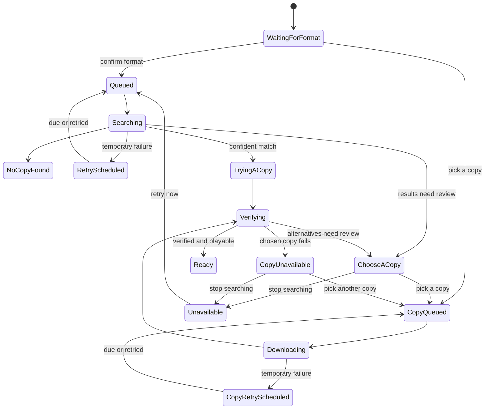

# Find copy states

A request follows one song through format selection, search, transfer, and playback. The request ID stays the same when you retry, choose a different version of the recording, or pick another file. A different recording selected from an already playable song can start its own request.

Use **Find all copies** on a playlist to queue missing songs across the entire playlist. The **Needs review** button in the top bar opens requests that need attention. To change a playable song’s audio, choose **Replace copy** from its song menu and select a candidate. The song keeps its place in the library and playlists. The current copy stays playable until the replacement passes verification.

Requests, Deep Dive, and Weekly Discovery use a rounded status chip alongside the song and format. On narrow screens the controls wrap together. Labels and accessible action names carry the meaning alongside the chip color.

| State | What it means | Next action |
| --- | --- | --- |
| Waiting for format | The song is saved and needs a format. | Choose format or choose a recording. |
| Queued | A search is in line. | Retry now to prioritize it, or choose a recording. |
| Copy queued | The exact copy you chose is in line. | Retry now to prioritize it, or choose a recording. |
| Retry scheduled | The room will retry a temporary search or automatic transfer failure. | Wait or retry now. |
| Copy retry scheduled | The room will retry the chosen copy. | Wait or retry now. |
| Searching | The source is looking for possible copies. | Wait for the result. |
| Trying a copy | The room is testing an automatically picked candidate. | See transfer percentage when the source reports bytes. |
| Downloading | The room is transferring the copy you chose. | See transfer percentage when the source reports bytes. |
| Verifying | The room is checking the recording and audio. | Wait for verification. |
| Choose a copy | Search returned options that need your review. | Open Review copies to choose one or stop searching. |
| Copy unavailable after selection | The chosen file failed to transfer or pass verification. | Open Review copies to choose another or stop searching. |
| Unavailable | You stopped the search. The request stays visible and automatic searches skip it. | Retry now to return it to the search queue. |
| No copy found | Search found no usable copy in the requested format. | Change format or retry. Try MP3 appears after a lossless miss. |
| Search failed | The source failed or exhausted its retries. | Retry, change format, or edit the search. |
| Needs review | The download could not be verified. | Change format, edit the search, or review another recording. |
| Waiting for space | The room is holding the job until it has enough disk space. | Wait for space to become available. |
| Preparing playback | A verified library download is being indexed. | Wait for it to become playable. |
| Copy unavailable in library | A previously verified file is missing. | Check the room’s library storage. |
| Ready | The verified copy is available to play. | Play it on this device or send it to a room player. |

Changing a recording keeps the confirmed format and invalidates results from the previous recording. A draft still needs a format. Copy handles are tied to the request, revision, and format. A second confirmation cannot release a second transfer, and stale controls cannot replace an active transfer. The server keeps the existing queue status fields so older clients can still read the room.
